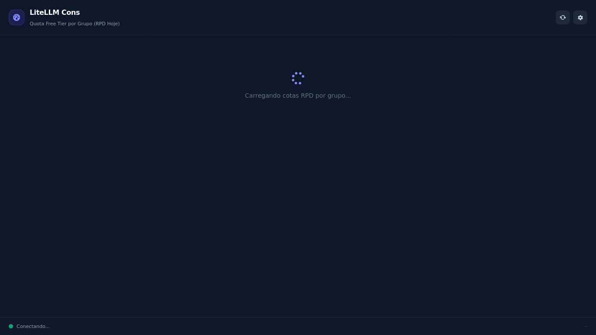

# LiteLLM Cons

Monitor de Quota RPD (Requests Per Day) por grupo de modelo para o gateway LiteLLM.

Acompanhe o consumo diário de requisições de cada modelo configurado no seu LiteLLM Gateway, com barras de progresso, limites configuráveis por grupo e interface responsiva (desktop e mobile/iPhone).

## Preview



## Recursos

- 📊 Lista de grupos de modelos com consumo RPD do dia
- 📈 Barra de progresso visual com cores por nível de uso
- ⚙️ Configuração de limites RPD por grupo (ex: `groq-fast`, `gemini-fallback`, `or-super-vl`, etc.)
- 🌐 Endpoints de API REST (`/api/config`, `/api/models`, `/api/usage`)
- 📱 Responsivo para celulares (viewport mobile, fontes adaptáveis)
- 🔁 Atualização automática a cada 30 segundos
- ⏳ Processo gerenciado pelo PM2 com reinício automático

## Instalação

### 1. Clonar o repositório

```bash
git clone https://github.com/brodrigos/litellm-cons.git
cd litellm-cons
```

### 2. Instalar dependências

O servidor web usa apenas **Express** (sem Electron necessário para rodar no servidor):

```bash
npm install
```

> O `package.json` original continha `electron` e `electron-builder` como `devDependencies`. Para rodar como serviço web no servidor, removemos essas dependências e mantemos apenas `express`.

### 3. Configurar o LiteLLM Gateway

Edite as variáveis de ambiente ou o arquivo de configuração gerado automaticamente na primeira execução:

- `LITELLM_HOST` — IP do gateway LiteLLM (padrão: `192.168.1.130`)
- `LITELLM_PORT` — Porta do gateway (padrão: `4000`)
- `LITELLM_API_KEY` — Chave master/Bearer do LiteLLM (padrão: `1234`)
- `PORT` — Porta do servidor LiteLLM Cons (padrão: `3031`)

Exemplo:

```bash
export LITELLM_HOST=192.168.1.130
export LITELLM_PORT=4000
export LITELLM_API_KEY=1234
export PORT=3031
```

### 4. Iniciar o servidor

Com PM2 (recomendado para produção):

```bash
npm install -g pm2
PORT=3031 pm2 start server.js --name litellm-cons
pm2 save
pm2 startup systemd -u $USER --hp $HOME
```

Ou simplesmente:

```bash
PORT=3031 node server.js
```

O servidor ficará disponível em: **http://SEU_IP:3031**

## Endpoints da API

| Método | Caminho | Descrição |
|--------|---------|-----------|
| `GET` | `/` | Painel principal (HTML) |
| `GET` | `/settings.html` | Página de configurações RPD |
| `GET` | `/api/config` | Retorna configuração atual |
| `POST` | `/api/config` | Salva nova configuração |
| `GET` | `/api/models` | Lista modelos ativos no gateway LiteLLM |
| `GET` | `/api/usage` | Retorna consumo RPD do dia por grupo |

## Configurações RPD

Na aba **Configurações**, você pode definir o limite máximo de requisições por dia para cada grupo de modelo. Os valores padrão são:

| Grupo | Limite RPD |
|-------|------------|
| default | 1500 |
| groq-fast | 14400 |
| gemini-3.5-flash-lite | 1500 |
| or-super-vl | 200 |
| or-flint | 200 |

## Ordenação

Os grupos são exibidos em ordem decrescente de consumo (maior número de requisições hoje primeiro), facilitando a identificação de modelos próximos do limite.

## Tecnologias

- [Node.js](https://nodejs.org/) + [Express](https://expressjs.com/)
- [Tailwind CSS](https://tailwindcss.com/) (via CDN)
- [Font Awesome](https://fontawesome.com/) (ícones)
- [PM2](https://pm2.keymetrics.io/) (gerenciador de processos)

## Licença

MIT
